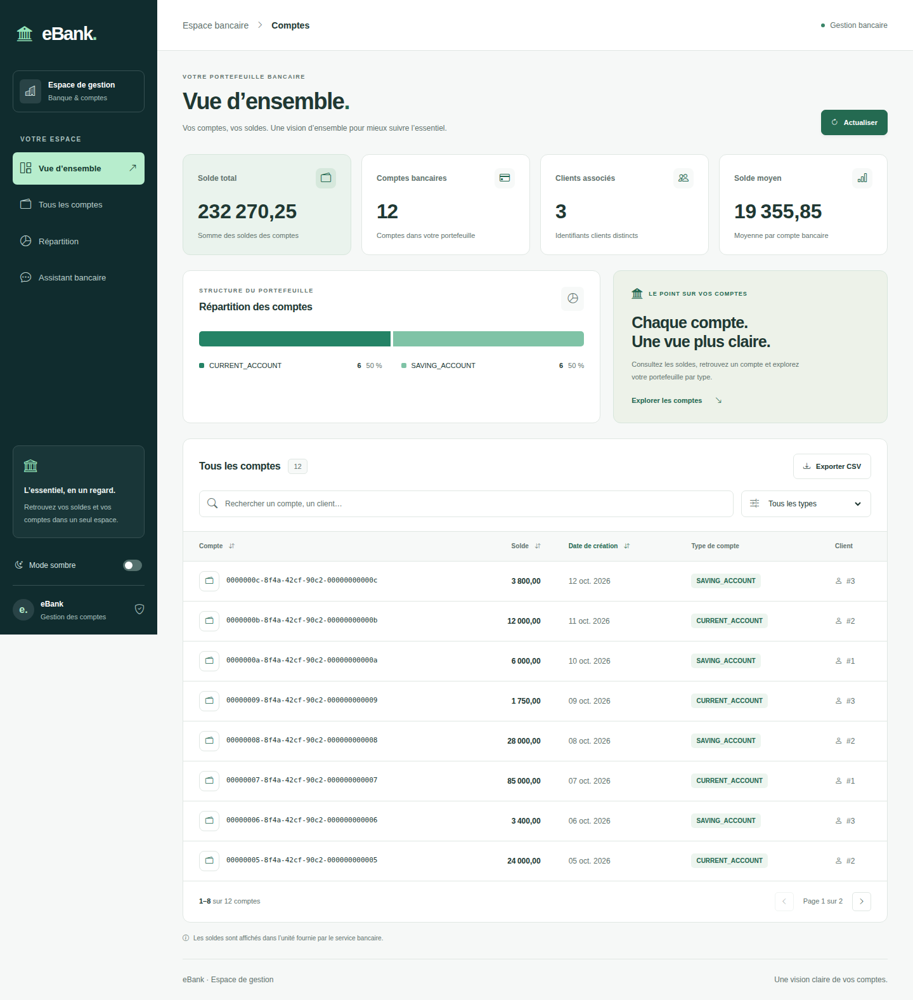
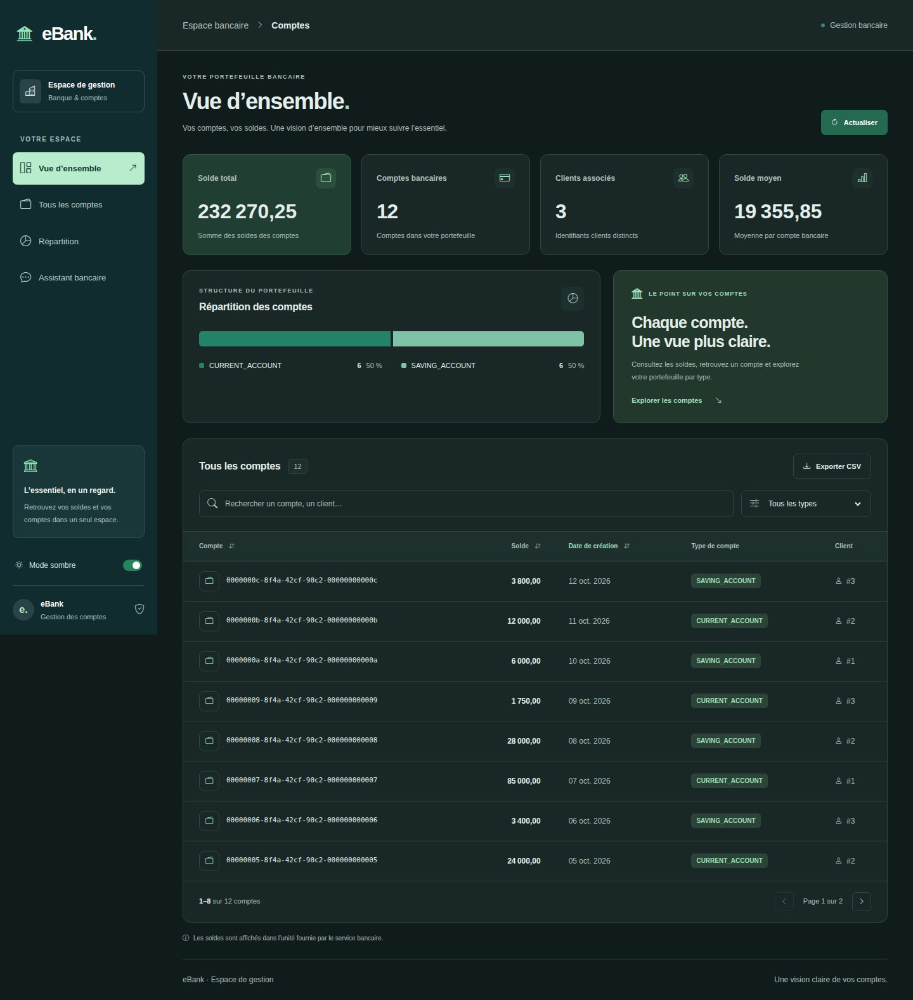
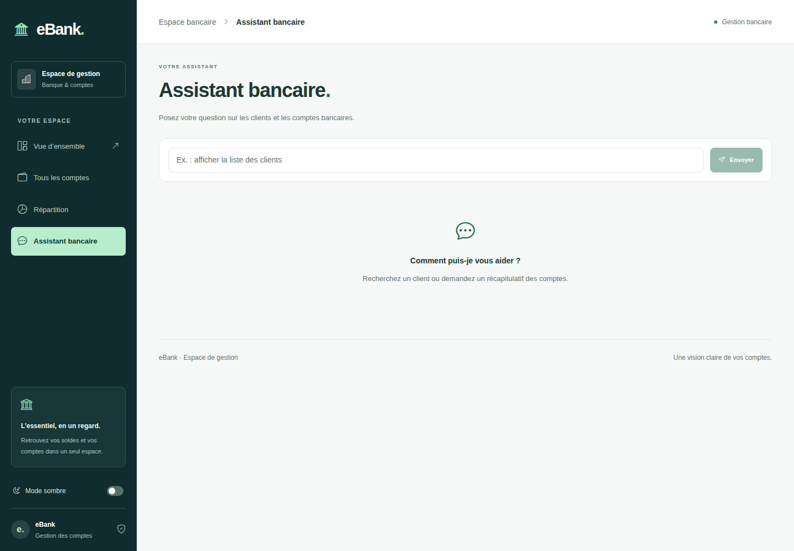
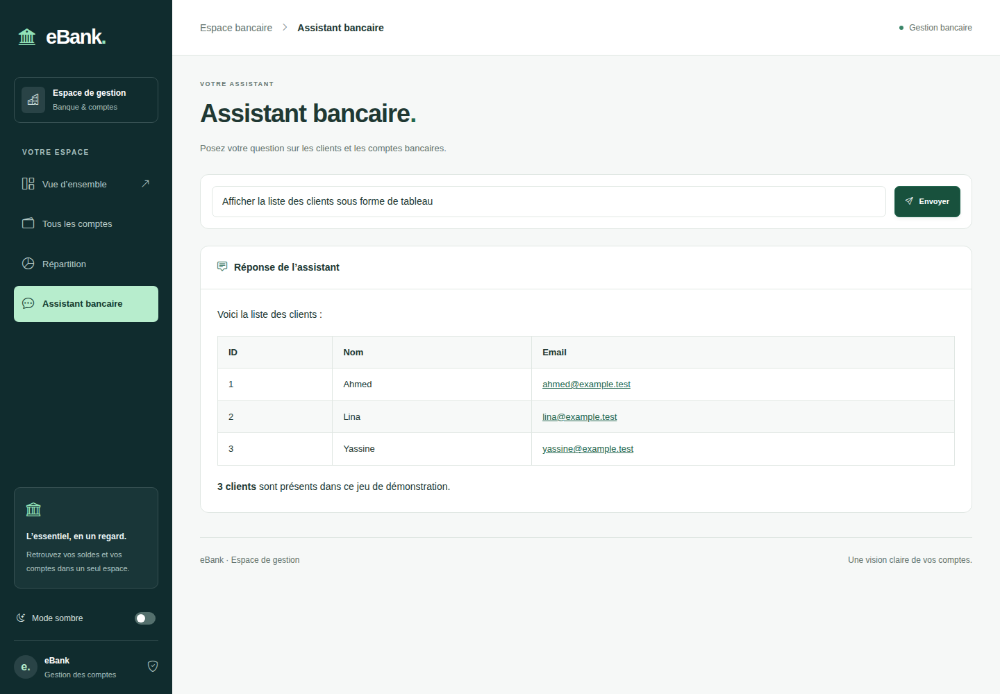
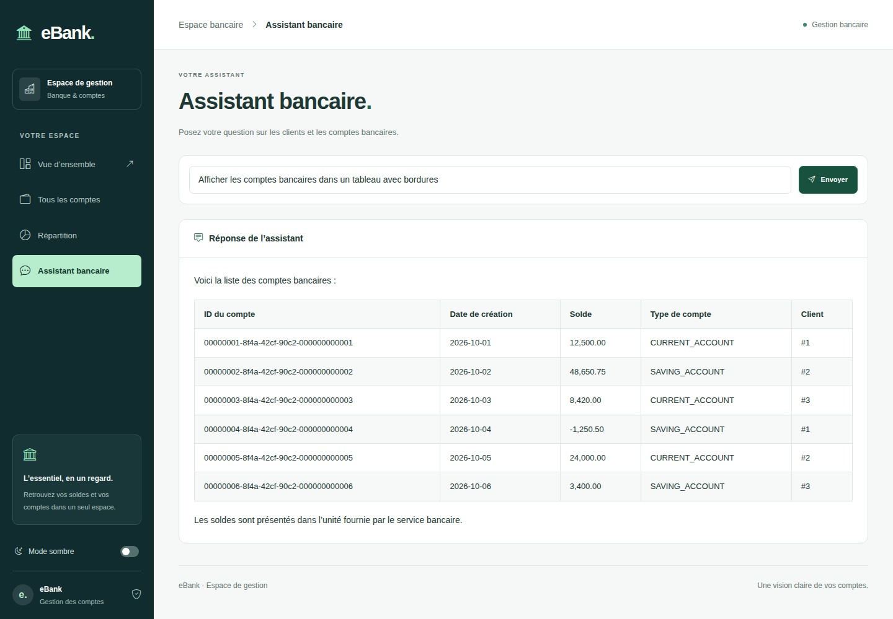
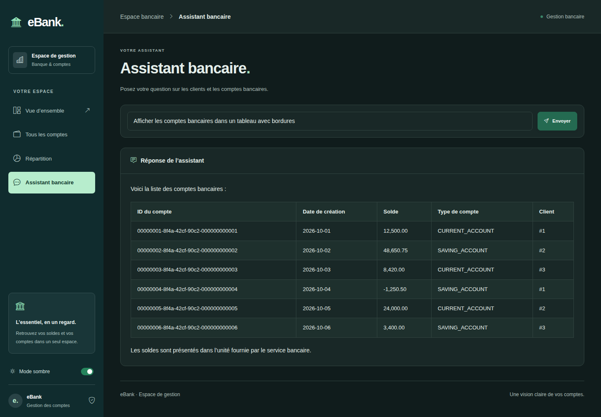
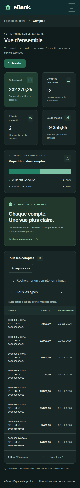
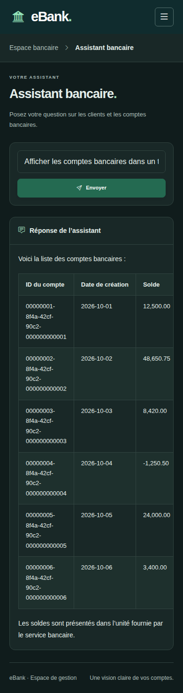

# eBank — Gestion bancaire & assistant IA

Application bancaire composée de microservices Spring et d’un frontend Angular. Elle permet de consulter les comptes, d’explorer leurs soldes et d’interroger un assistant bancaire avec des réponses Markdown reçues en streaming.

## Aperçu de l’application

Les captures ci-dessous montrent les deux pages disponibles : **comptes** (`/accounts`) et **assistant bancaire** (`/bot`), sur desktop et mobile, en clair et en sombre.

> Captures réalisées dans Chromium avec des données de démonstration et des réponses SSE simulées : le backend n’était pas joignable lors de la capture. Les noms, adresses `example.test` et montants sont illustratifs. Aucune donnée de démonstration n’est injectée dans le code de production.

### Dashboard — desktop

Indicateurs calculés, répartition par type et liste des comptes avec recherche, filtres, tri, pagination et export CSV.



### Dashboard — mode sombre



### Assistant — accueil



### Assistant — réponse des clients

Les espaces et les retours à la ligne du flux sont conservés. Le Markdown devient un véritable tableau avec en-têtes, lignes et bordures.



### Assistant — réponse des comptes



### Assistant — mode sombre



### Versions mobiles

Le menu est repliable. Les tableaux défilent horizontalement dans leur zone, sans élargir la page.

| Dashboard | Assistant bancaire |
| --- | --- |
|  |  |

## Organisation

| Dossier | Rôle |
| --- | --- |
| `angualr-front/` | Interface Angular 21, Tailwind CSS 4, Signals et Markdown |
| `customer-service/` | Service clients |
| `ebank-service/` | Service des comptes bancaires |
| `ebank-boot/` | Assistant bancaire IA et endpoints de chat |
| `gateway-service/` | Passerelle API |
| `discovery-service/` | Découverte des services |
| `docs/screenshots/` | Captures réelles du frontend avec les données de démonstration décrites ci-dessus |

## Lancer le frontend

Prérequis : Node.js compatible avec Angular 21 et npm.

```sh
cd angualr-front
npm install
npm start
```

Ouvrir [http://localhost:4200](http://localhost:4200). Les services backend doivent être démarrés séparément, avec la passerelle accessible sur `http://localhost:9999`.

Endpoints utilisés par le frontend :

- `GET /EBANK-SERVICE/bankAccounts`
- `GET /EBANK-BOOT/chat?query=...`
- `GET /EBANK-BOOT/chatStream?query=...`

## Vérifications

Depuis `angualr-front/` :

```sh
npm run build
npm test -- --watch=false
```

Dernière validation : **compilation de production sans avertissement et 17 tests réussis**. Les régressions du flux SSE sont couvertes : conservation des espaces, des paragraphes et des tableaux, fragments incomplets, progression cumulative, erreur réseau et rendu Markdown assaini.

Le navigateur a également vérifié les tableaux avec bordures et l’absence de débordement de page à 390 px.

## Correction de l’affichage des réponses

Le parseur précédent supprimait les espaces au début des fragments et concaténait les lignes SSE sans restaurer leurs sauts de ligne. Les mots se collaient et les tableaux Markdown restaient du texte brut.

Le parseur `spring-sse.ts` conserve le contenu écrit par le endpoint Spring `Flux<String>`, assemble les lignes d’un même événement avec leurs retours à la ligne et attend la fin des événements incomplets. Les règles `.assistant-markdown` mettent en forme tableaux, listes, titres et blocs de code dans les deux thèmes. L’assainissement HTML de `ngx-markdown` reste actif.

Ce parseur cible le format Spring utilisé ici, qui écrit `data:` directement devant le fragment ; il n’enlève donc pas les espaces du fragment. Référence : [sérialisation SSE de Spring](https://github.com/spring-projects/spring-framework/blob/v7.0.0/spring-webmvc/src/main/java/org/springframework/web/servlet/mvc/method/annotation/SseEmitter.java).

Les choix de design et d’architecture sont détaillés dans [angualr-front/DESIGN.md](angualr-front/DESIGN.md).
