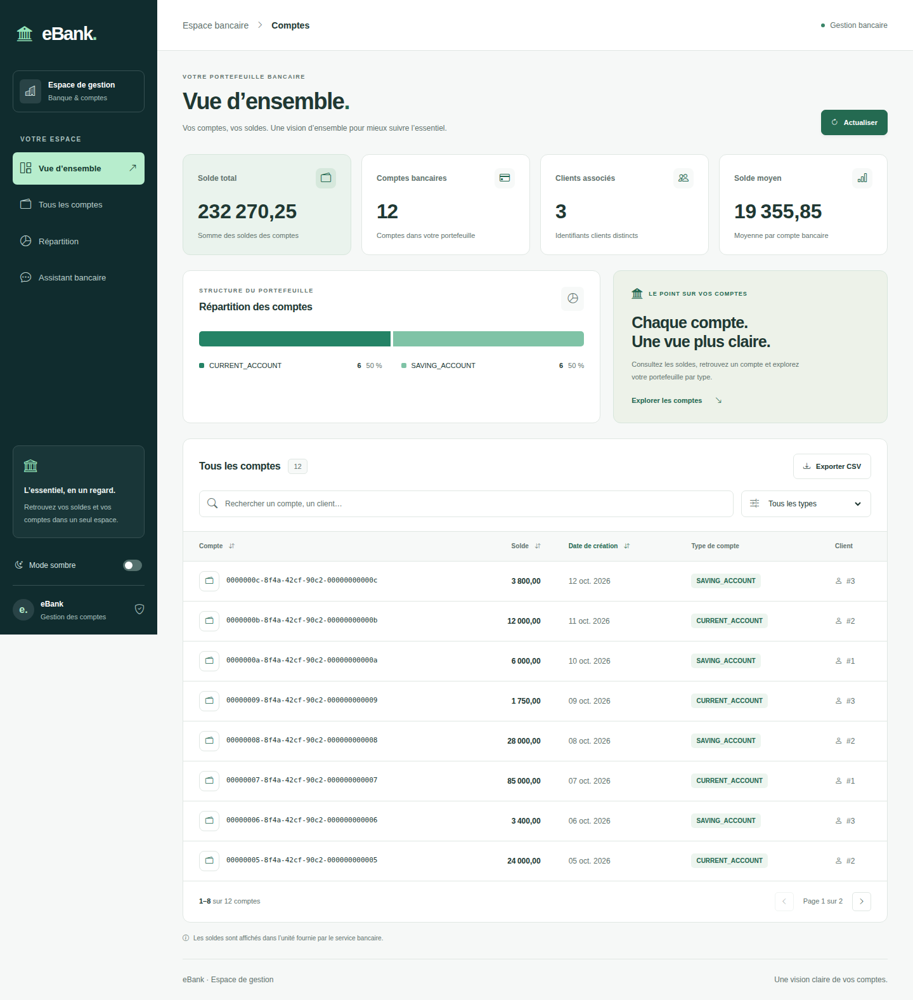
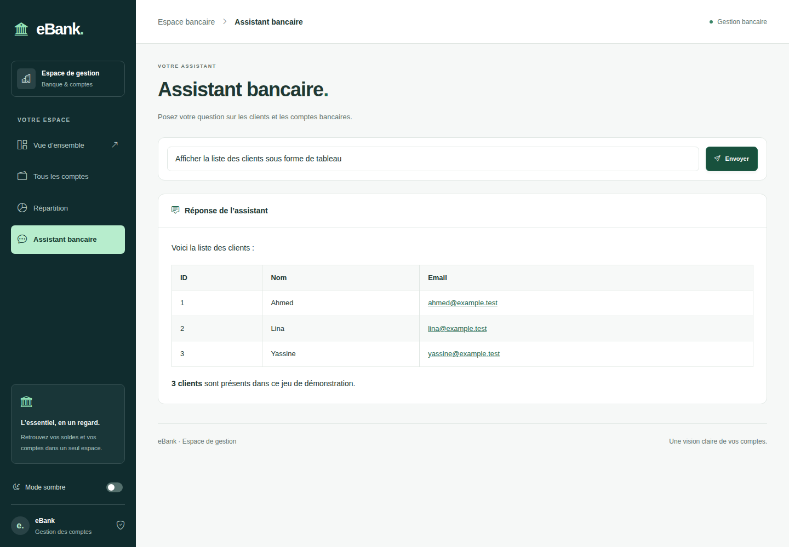

# Frontend eBank

Interface Angular 21 et Tailwind CSS 4 pour consulter les comptes bancaires et interroger l’assistant IA.

## Captures d’écran

La [galerie complète dans le README du projet](../README.md#aperçu-de-lapplication) présente les deux pages, leurs modes clair/sombre et leurs versions mobiles. Les captures utilisent des données de démonstration ; elles ne représentent pas des données bancaires réelles.





## Démarrage

```sh
npm install
npm start
```

Ouvrir `http://localhost:4200/accounts` ou `http://localhost:4200/bot`.
La passerelle backend doit être accessible sur `http://localhost:9999`.

## Validation

```sh
npm run build
npm test -- --watch=false
```

Compilation de production et 17 tests vérifiés. Le traitement SSE conserve les espaces, les retours à la ligne et la structure des tableaux Markdown. Les styles des réponses prennent en charge le mode sombre et les tableaux défilants sur mobile.

Consulter [DESIGN.md](DESIGN.md) pour les détails d’architecture, de réactivité et d’accessibilité.
